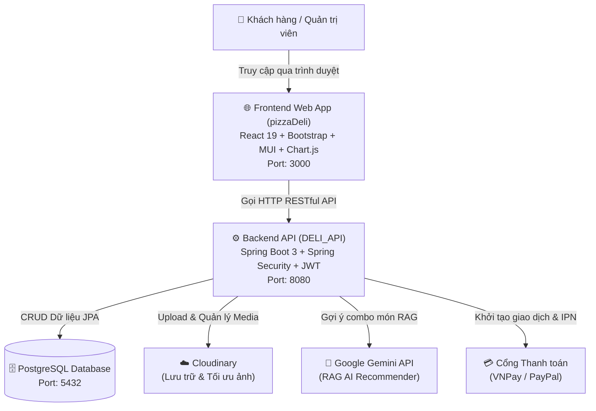

# 🍕 Hệ Thống Đặt Hàng & Quản Lý Nhà Hàng Pizza Deli (Fullstack)

> **Giải pháp chuyển đổi số toàn diện cho chuỗi nhà hàng Pizza Deli**: Kết hợp giữa giao diện Web Client/Admin hiện đại (**React 19**), hệ thống Backend xử lý phân tán mạnh mẽ (**Spring Boot 3 + PostgreSQL**), thanh toán đa kênh trực tuyến (**VNPay**, **PayPal**, **VietQR**) và **Trợ lý tư vấn ẩm thực thông minh ứng dụng RAG AI (Google Gemini)**.

---

## 🏛️ Kiến trúc hệ thống tổng quan

Hệ thống được thiết kế theo mô hình tách biệt độc lập giữa Frontend và Backend (**Client - Server Architecture**), giao tiếp thông qua **RESTful API**:



---

## 📂 Các dự án thành phần

Hệ thống gồm 2 dự án độc lập nằm trong workspace:

| Dự án | Thư mục | Ngôn ngữ / Công nghệ | Vai trò | Chi tiết |
| :--- | :--- | :--- | :--- | :---: |
| **Backend API** | [`DELI_API`](./DELI_API) | Java 17, Spring Boot 3, PostgreSQL, JWT | Cung cấp RESTful API, xác thực bảo mật, xử lý đơn hàng & tích hợp AI | [Xem README Backend](./DELI_API/README.md) |
| **Frontend Web** | [`pizzaDeli`](./pizzaDeli) | React 19, React Router v7, Bootstrap 5, MUI | Giao diện đặt hàng cho thực khách & Bảng điều khiển quản trị (Dashboard) | [Xem README Frontend](./pizzaDeli/README.md) |

---

## ✨ Điểm nhấn công nghệ của hệ thống

1. **Trợ lý ẩm thực RAG AI (Retrieval-Augmented Generation)**:
   - Thay vì chỉ chat thông thường, trợ lý AI truy vấn trực tiếp vào danh sách món ăn thực tế có trong kho để tạo ra combo gợi ý chính xác theo ngân sách, số lượng người và sở thích cá nhân.
2. **Thanh toán đa phương thức hiện đại**:
   - Tích hợp cổng thanh toán nội địa **VNPay** và quốc tế **PayPal**.
   - Tự động sinh mã **VietQR** chuẩn Napas cho phép quét mã chuyển khoản nhanh chóng.
3. **Quản lý đơn hàng & Xuất hóa đơn bán lẻ**:
   - Cập nhật luồng xử lý đơn hàng theo thời gian thực.
   - Xuất hóa đơn bán lẻ dạng file **PDF** chuyên nghiệp và mã QR xác thực đơn.
4. **Bảo mật chuẩn công nghiệp**:
   - Xác thực người dùng bằng cơ chế **JWT (Stateless Authentication)**, mã hóa mật khẩu và phân quyền nghiêm ngặt giữa khách hàng và quản trị viên.

---

## ⚡ Hướng dẫn cài đặt & Khởi chạy nhanh (Quick Start)

### 1. Khởi động Cơ sở dữ liệu (PostgreSQL)
- Đảm bảo dịch vụ PostgreSQL đang chạy ở cổng mặc định `5432`.
- Tạo database tên `pizzadeli` (hoặc cấu hình theo `application.properties`):
  ```sql
  CREATE DATABASE pizzadeli;
  ```

### 2. Khởi chạy Backend (`DELI_API`)
```bash
# Mở một cửa sổ Terminal 1
cd DELI_API

# Trên Windows
./mvnw.cmd spring-boot:run

# Trên Linux/macOS
./mvnw spring-boot:run
```
- API chạy tại: `http://localhost:8080`
- Swagger UI tài liệu API: `http://localhost:8080/swagger-ui/index.html`

### 3. Khởi chạy Frontend (`pizzaDeli`)
```bash
# Mở một cửa sổ Terminal 2
cd pizzaDeli

# Cài đặt gói thư viện
npm install

# Khởi chạy giao diện
npm start
```
- Giao diện người dùng mở tại: `http://localhost:3000`

---

## 📄 Tài liệu chi tiết từng phân hệ
Vui lòng xem hướng dẫn chi tiết về cấu hình, biến môi trường và danh sách API tại các liên kết sau:
- 📖 [Tài liệu chi tiết Backend (DELI_API)](file:///e:/Pizza/DELI_API/README.md)
- 📖 [Tài liệu chi tiết Frontend (pizzaDeli)](file:///e:/Pizza/pizzaDeli/README.md)
